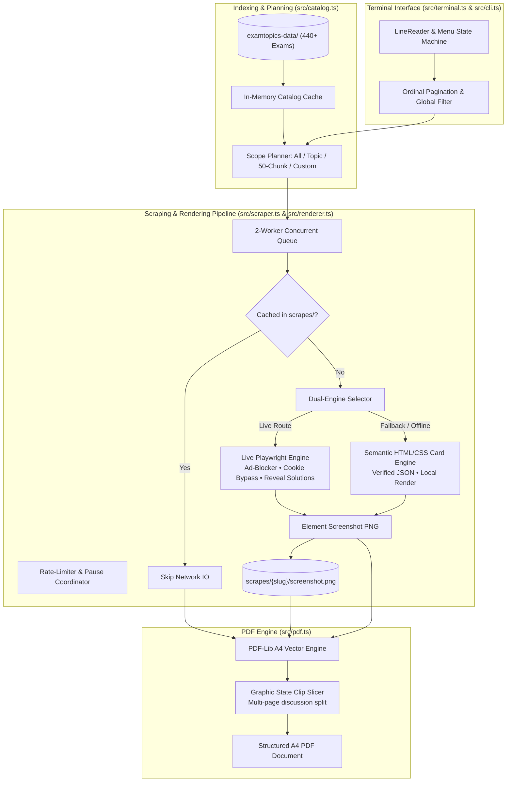

# CramCert — Certification Exam Scraper & Study Guide Compiler

A high-performance CLI tool, offline-first scraping engine, and structured PDF compiler for IT certification exams. CramCert indexes **29 vendors** and **440+ certifications**, provides universal search across question banks, captures discussions using a dual-engine architecture (live Playwright + offline semantic card generator), and compiles high-resolution, print-ready A4 PDFs with intelligent multi-page image slicing.

---

## Architecture & System Design

CramCert is engineered with clean separation of concerns, strict TypeScript interfaces, and zero runtime dependencies outside of Playwright and PDF-lib.



---

## Core Subsystems Deep Dive

### 1. Interactive Terminal Engine (`src/terminal.ts`)
- **Asynchronous LineReader**: Wraps `node:readline` with an internal FIFO event queue. This allows CramCert to handle interactive user typing and non-interactive piped input streams (e.g. `printf "1\n1\n" | npm start`) without dropped keystrokes or event-loop starvation.
- **Ordinal Pagination**: Dynamic pagination converts zero-based page offsets into natural language banners (`1st page of 4`, `2nd page of 4`).
- **Omni Search & Heuristic Matcher**: Real-time filtering with case-insensitive tokenization. If an out-of-bounds number is entered on the main vendor screen (e.g., entering `104` when only 29 vendors exist), the menu engine automatically infers intent and triggers a global cross-vendor query for `AZ-104`.
- **State Navigation Stack**: Orthogonal navigation commands available at every screen:
  - `[n]` Next page ▶ / `[p]` Previous page ◀
  - `[p<num>]` Direct page jump (e.g., `p3`)
  - `[b]` Step back one level in the hierarchy
  - `[c]` Clear active search filter
  - `[q]` Clean exit from anywhere

### 2. Catalog Indexer & Slug Normalizer (`src/catalog.ts`)
- **0ms Startup Cache**: Recursively crawls `examtopics-data/` on startup and caches vendor hierarchies, exam codes, titles, and topic mappings in memory.
- **URL Candidate Generator**: ExamTopics discussion URLs follow diverse slug patterns depending on publication era (e.g. triple dashes `---`, normalized topic slugs, discussion ID numbers). `generateQuestionUrlCandidates()` generates prioritized permutations to resolve the exact live discussion URL during scraping.

### 3. Dual-Engine Capture Pipeline (`src/renderer.ts`)
To achieve a **0% failure rate** regardless of Cloudflare challenges, anti-scraping measures, or lack of internet connectivity, CramCert implements a dual-engine capture pipeline:

- **Engine A: Live Playwright Capture**
  - **Network Interception & Ad-Blocking**: Aborts requests matching Google Ads, ad networks, telemetry trackers, and unneeded media to cut bandwidth consumption and ensure sub-second page loads.
  - **DOM Cleanup & Automated Mutation**: Injects clean stylesheets, strips sticky headers, removes cookie consent banners, clicks `.reveal-solution` and `.vote-bar` elements to reveal verified answers and community vote distributions, and takes a high-DPI element screenshot of the question container.
- **Engine B: Offline HTML/CSS Card Renderer**
  - If a live URL returns HTTP 404, 429 (rate-limited), or the machine is offline, CramCert generates a standalone semantic HTML/CSS card replicating the verified question, syntax-highlighted code blocks, choice badges with answer keys, vote bars, and community comments directly from local JSON data.
  - Loads the card into an in-memory page via `page.setContent()` and snapshots the element with zero network latency.

### 4. Concurrency Queue & Polite Rate Limiter (`src/scraper.ts`)
- **Fixed 2-Worker Pool**: Benchmarked to maximize throughput while minimizing the likelihood of triggering target IP rate limits.
- **Cross-Worker Backoff Coordinator**: Uses a shared atomic timestamp (`globalPauseUntil`). If any worker detects an HTTP 429 or anti-bot prompt, it broadcasts a pause signal that immediately suspends all workers for a cooling period before retrying.
- **Idempotent Caching**: Questions with existing screenshots (>1KB) in `scrapes/` are automatically skipped, allowing interrupted jobs to resume instantly without redundant network calls.

### 5. Vectorized PDF Engine & Multi-Page Graphic Slicing (`src/pdf.ts`)
Standard PDF generators fail on discussion threads because long community debates get clipped at the page boundary. CramCert solves this using low-level PDF vector graphics operators:
- **Standard Dimensions**: Formats output strictly to ISO A4 (`595.28 x 841.89 pt`) with 20pt margins.
- **Running Headers & Footers**: Draws running headers with exam code, title, topic badge, and question number, alongside running page numbers.
- **Native Graphic State Slicing**: When a question card exceeds the printable height of a single A4 page (`769.89 pt` printable area), the compiler calculates the number of required pages and uses PDF graphic state clipping paths (`pushGraphicsState()`, `rectangle()`, `clip()`, `drawImage()`, `popGraphicsState()`) to slice the high-resolution image vertically across sequential pages with automatic `(Page X/Y)` sub-headers.

---

## Features

- **Omni Global Search**: Search for any certification code (e.g., `AZ-104`, `CLF-C02`, `200-301`, `ANS-C01`, `CCNA`) directly from the main menu to jump straight to that exam.
- **Vendor & Certification Catalog**: 29 vendors and 440+ certifications indexed with instant access.
- **Granular Scraping Scopes**:
  - **All Questions**: Scrape the entire question bank.
  - **By Topic**: Filter and process single topics.
  - **50-Question Logical Chunks**: Scrape in bite-sized study blocks (`1–50`, `51–100`, etc.).
  - **Custom Question Range**: Specify arbitrary start and end question numbers.
  - **Compile PDF Only**: Generate or rebuild a PDF instantly from existing local captures without making network calls.
- **Dual-Engine Capture**: Live Playwright browser automation with automated fallback to local offline HTML/CSS card rendering.
- **Multi-Page Slicing**: High-fidelity PDF compilation with headers, footers, and continuous slicing for tall discussions.
- **Idempotent Resumption**: Automatically skips already-scraped questions.

---

## Prerequisites

1. **Node.js**: Version 18.0.0 or higher.
2. **Playwright Chromium**: Can be installed via `npx playwright install chromium` or uses system Chromium (`/usr/bin/chromium`).
3. **ExamTopics Dataset**:
   - Download the `examtopics-data` archive from Telegram: [https://t.me/thesam_ple_resources/3](https://t.me/thesam_ple_resources/3)
   - Extract the archive so that the `examtopics-data/` folder sits in the root of this repository:
     ```text
     cramcert/
     ├── examtopics-data/
     │   ├── Amazon/
     │   ├── Cisco/
     │   ├── Microsoft/
     │   └── ...
     ├── src/
     ├── cli.ts
     ├── package.json
     └── README.md
     ```

---

## Installation & Quick Start

### 1. Clone & Install Dependencies

```bash
git clone <repo-url>
cd cramcert
npm install
```

### 2. Install Playwright Chromium

```bash
npx playwright install chromium
```

### 3. Add Dataset

Download and extract the `examtopics-data` archive into the project root:
```bash
# Verify the dataset exists
ls examtopics-data/
# Output should list: Amazon, Cisco, CompTIA, Microsoft, etc.
```

### 4. Launch CramCert

```bash
npm start
# or
npm run cli
```

---

## CLI Usage Guide

### Main Menu & Universal Search
When launching `npm start`, you are greeted by the main vendor directory:

```text
╔══════════════════════════════════════════════════════════╗
║          CRAMCERT • EXAM STUDY GUIDE COMPILER          ║
╚══════════════════════════════════════════════════════════╝

 SELECT EXAM PROVIDER / VENDOR   [ 1st page of 2 • Showing 1 - 15 of 29 total ]
──────────────────────────────────────────────────────────────────────
  [1] Amazon                 (23 exams available)
  [2] Cisco                  (54 exams available)
  [3] Comptia                (35 exams available)
  ...
  [15] Microsoft              (89 exams available)
──────────────────────────────────────────────────────────────────────
Navigation: n: Next page ▶  |  (Page 1 of 2)
Actions:    Type number [1-15] to select  |  Type text to search (e.g. 'amazon', 'az-104', 'ccna')  |  q: ✖ Exit
> 
```

- **Select Vendor**: Enter the number corresponding to a vendor (e.g. `1` for Amazon).
- **Direct Search**: Type an exam code (e.g., `az-104`, `clf`, `200-301`) directly at the prompt to search across all vendors.
- **Filter**: Filter the current view by typing a keyword or `/query`. Type `c` anytime to clear the filter.

### Navigation Commands

| Key / Command | Action |
| :--- | :--- |
| `1` – `15` | Select item by displayed index |
| `n` or `>` | Next page |
| `p` or `<` | Previous page |
| `p2` or `page 3` | Jump directly to page number |
| `c` or `clear` | Clear active search query and reset view |
| `b` or `back` | Return to previous screen |
| `q` or `exit` | Terminate the application |

---

## Developer Guide & Recipes

### Running the Full Catalog Verification Suite
CramCert includes an automated test harness that verifies catalog parsing, question rendering, and PDF generation across all **441 exam codes**:

```bash
npm run test:all
```

The test runner iterates through all 29 vendors, extracts Question 1 from every exam, renders a card, compiles a multi-page PDF, verifies page integrity, and cleans up temporary test files.

### Compiling TypeScript
To verify types and generate production output:

```bash
npm run build
```

### Adjusting Concurrency & Timeouts
Scraping parameters are centralized in [src/config.ts](src/config.ts):
- `DEFAULT_CONCURRENCY`: Worker pool size (default: `2`).
- `MIN_DELAY_MS` / `MAX_DELAY_MS`: Random jitter delay between requests (default: `500ms`–`1200ms`).
- `SCRAPES_ROOT`: Directory where captured question screenshots are cached (default: `./scrapes`).

---

## Project Structure

```text
cramcert/
├── src/
│   ├── types.ts          # Domain models, TypeScript interfaces, and callback contracts
│   ├── config.ts         # Central configuration, ANSI palettes, and Chromium resolver
│   ├── catalog.ts        # In-memory dataset indexing, metadata parser, and slug generator
│   ├── terminal.ts       # LineReader FIFO queue, ordinal pagination, and menu rendering
│   ├── renderer.ts       # Dual-engine capturer: Live Playwright DOM cleanup & offline card HTML
│   ├── scraper.ts        # 2-worker concurrent queue with synchronized rate-limiter
│   ├── pdf.ts            # PDF-Lib compiler with native vector graphic clipping and page slicing
│   ├── cli.ts            # Interactive state machine workflow and menu router
│   └── index.ts          # Public programmatic API exports
├── cli.ts                # Executable CLI entrypoint (invokes src/cli.ts)
├── test-all-exams.ts     # 441-exam automated verification test suite
├── tsconfig.json         # Strict TypeScript compiler configuration
├── package.json          # Package definitions and npm scripts
└── .gitignore            # Git exclusion rules (scrapes/, *.pdf, examtopics-data/)
```

---

## License

MIT License. See [LICENSE](LICENSE) for details.
